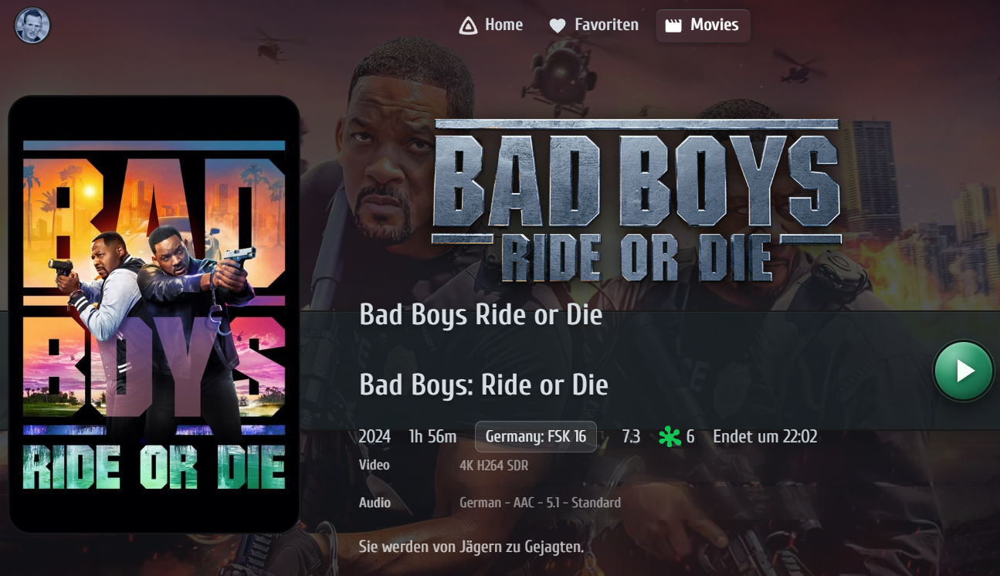
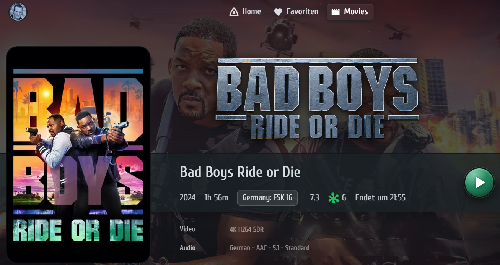

# Fix: Duplicate Movie Titles in the Detail Ribbon

**Jellyfin Nova · Theme Bug Fix · Movie Detail Page**

This document describes a presentation issue identified in the inherited theme implementation and corrected during the development of Jellyfin Nova.

The issue affects the movie detail page when both a primary title and an original title are available.

## The Problem

Jellyfin correctly provides different metadata fields for a movie, including its primary title and original title.

However, the inherited theme presentation could display both titles inside the same information ribbon.

This resulted in two visible headings, unnecessary vertical spacing, and a disrupted layout.

### Before — Duplicate Movie Titles



**Observed behavior:** The primary movie title and the additional original title appear together in the information ribbon. The second heading increases the height of the title area and pushes the movie information downward.

## The Jellyfin Nova Fix

We investigated the rendered movie detail page using the browser's developer tools.

The affected page contained two separate title elements:

- Primary title: `.itemName`
- Original title: `.itemName.originalTitle`

The original-title element was responsible for the additional visible heading.

Jellyfin Nova now hides only that additional element within the movie detail ribbon, while preserving the primary title and the underlying metadata.

### After — Corrected Movie Detail Ribbon



**Corrected behavior:** Only the primary movie title is visible. The information ribbon retains its intended compact layout, with movie metadata and playback controls positioned correctly.

## Technical Solution

The fix is implemented in:

[`src/styles/core/detail.css`](../../src/styles/core/detail.css)

The following targeted CSS rule prevents the duplicate heading:

```css
#itemDetailPage .detailRibbon .nameContainer .itemName.originalTitle {
    display: none !important;
}
```

The selector is deliberately restricted to the movie detail ribbon.

It does not globally hide original titles elsewhere in Jellyfin, and it does not change or remove any movie metadata, database records, or NFO files.

## Investigation and Verification

The problem was reproduced and examined directly in the browser before the permanent CSS correction was added to the Jellyfin Nova source code.

The verification included:

1. Inspecting the primary-title and original-title elements.
2. Confirming that both headings were displayed in the affected information ribbon.
3. Applying the targeted CSS correction during a live browser test.
4. Confirming that the additional heading disappeared and the compact layout was restored.
5. Building the updated theme and running the automated project tests.

**Verification result:** The CSS build completed successfully, and all 14 automated tests passed.

The screenshots above illustrate the original presentation problem and the corrected Jellyfin Nova result.

## Fix Reference

<table width="1012" style="width:1012px;table-layout:fixed;">
<tr><th width="261" style="width:261px;" align="left">Item</th><th width="751" style="width:751px;" align="left">Details</th></tr>
<tr><td width="261" style="width:261px;" align="left">Project</td><td width="751" style="width:751px;" align="left">Jellyfin Nova</td></tr>
<tr><td width="261" style="width:261px;" align="left">Category</td><td width="751" style="width:751px;" align="left">Theme presentation bug</td></tr>
<tr><td width="261" style="width:261px;" align="left">Component</td><td width="751" style="width:751px;" align="left">Movie detail page / information ribbon</td></tr>
<tr><td width="261" style="width:261px;" align="left">Status</td><td width="751" style="width:751px;" align="left">Fixed in source</td></tr>
<tr><td width="261" style="width:261px;" align="left">Source file</td><td width="751" style="width:751px;" align="left"><code>src/styles/core/detail.css</code></td></tr>
<tr><td width="261" style="width:261px;" align="left">Fix commit</td><td width="751" style="width:751px;" align="left"><a href="https://github.com/topa-LE/jellyfin-nova/commit/136b002">136b002</a></td></tr>
<tr><td width="261" style="width:261px;" align="left">Commit message</td><td width="751" style="width:751px;" align="left"><code>fix: hide duplicate original movie titles in detail ribbon</code></td></tr>
</table>

## Important Distinction

This was a **theme presentation issue**, not a Jellyfin metadata bug.

Jellyfin's support for multiple title fields is intentional and remains unchanged.

The documented behavior was observed in the inherited theme implementation used as the basis for Jellyfin Nova. It does not establish that every upstream theme version exhibits the same issue.

---

*Jellyfin Nova — Improving the design, consistency, and usability of the inherited theme.*
